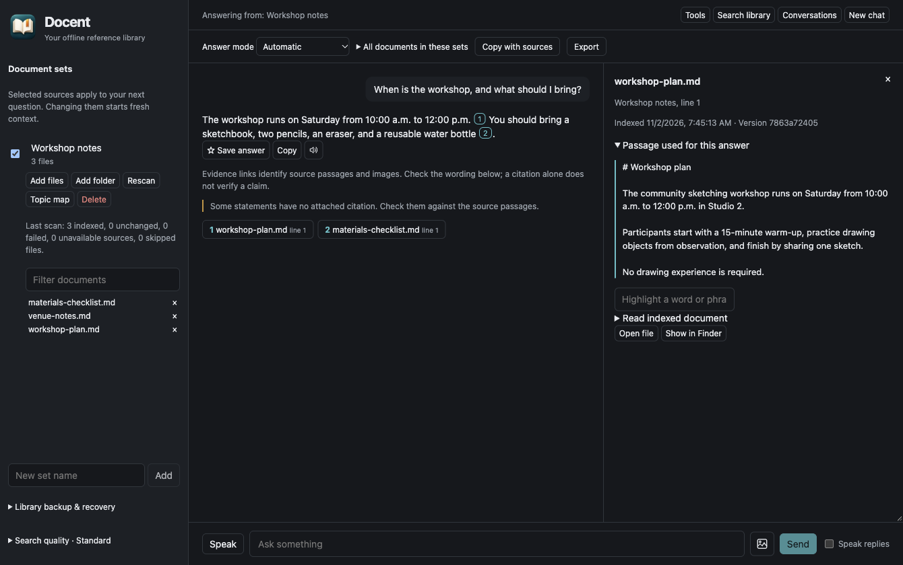

# Docent

Docent is a private, offline AI assistant for your documents. Add files, ask questions by typing or speaking, and follow citations back to the source. You can also ask about images and PDF pages, or chat using the model’s general knowledge.

*Example using sample workshop notes and a local model.*

## Get started

Download Docent from [Releases](https://github.com/yepher/docent-app/releases): **DMG** for macOS, **EXE** for Windows, or **AppImage / DEB** for Linux.

On first launch, download the local models once (about 2.3 GB). Allow at least 3 GB of disk space for models, plus room for your documents; 8 GB of memory is a starting point. After setup, document questions and voice work offline.

## Basic guide

1. **Add documents.** Create a document set and choose **Add files** or **Add folder**. You can also drag files or folders into Docent, then choose an existing set or create one. PDF, DOCX, Markdown, text, HTML, PNG/JPEG, and common data/code files are supported.
2. **Choose your sources.** Check the sets you want to use. **Automatic** mode answers from selected documents; with nothing selected, it uses general knowledge. **My documents only** and **General chat** let you choose explicitly. Changing sources starts fresh context and keeps the previous conversation saved.
3. **Ask a question.** Type and press **Send**, or use **Speak**, talk, then press **Stop**. To compare documents, select them under **All documents in these sets**.
4. **Check the answer.** Click a numbered citation to open its passage or PDF page. Use the search field (or **⌘/Ctrl+F**) to highlight words; **Enter / Shift+Enter** moves between matches. Choose **Document text** to search beyond the cited passage. Check important claims against the source; citations do not guarantee the model interpreted it correctly. Empty or failed selected sets never silently switch to general knowledge.
5. **Ask about a picture.** Attach or paste an image beside the question. For a PDF, choose **Read offline**, navigate to a page, then **Ask about this page**.
6. **Listen and save.** Use the speaker beside an answer to read it aloud, or enable **Speak replies**. **Save answer**, **Copy**, **Copy with sources**, and **Export** help keep useful results. Reopen past chats in **Conversations**.

## Useful controls

| Control | What it does |
| --- | --- |
| **Search library** | Finds files and passages without using the AI model. |
| **Rescan** | Picks up changes to imported files. Original files stay in place. |
| **Pronunciations** | Select a word in an answer to set its pronunciation. Use the list’s play and pencil icons to listen or edit. |
| **Search quality** | Enables the optional local relevance model for better passage selection. |
| **Topic map** | Explores a document set’s subjects visually. |
| **Tools** | Manages bundled and shared analysis tools. See the [tool guide](docs/tool-packages.md). |
| **Library backup & recovery** | Backs up or restores documents, conversations, and pronunciations. Models are separate. |
| **Check for Updates…** | Checks manually. Supported installed builds also download updates automatically and install on quit or **Restart to update**. |

Documents, questions, and voice stay on your computer. Internet access is used for model downloads, app updates, and tool repositories you request.

For help, use **Help → Report an Issue…** or [GitHub Issues](https://github.com/yepher/docent-app/issues). For development, testing, and releases, see [CONTRIBUTING.md](CONTRIBUTING.md). The app is [MIT licensed](LICENSE); models have [separate licenses](CONTRIBUTING.md#licenses).
